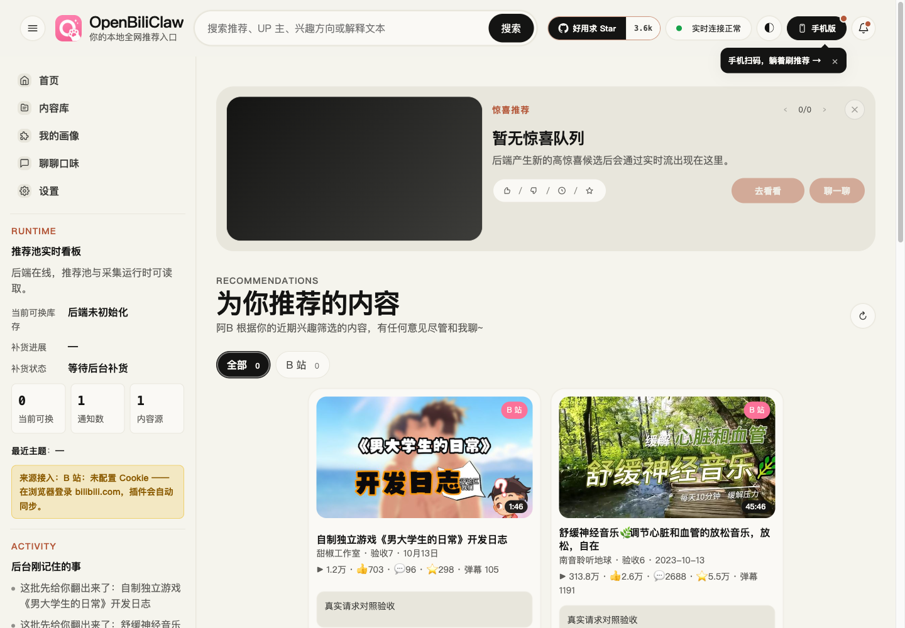
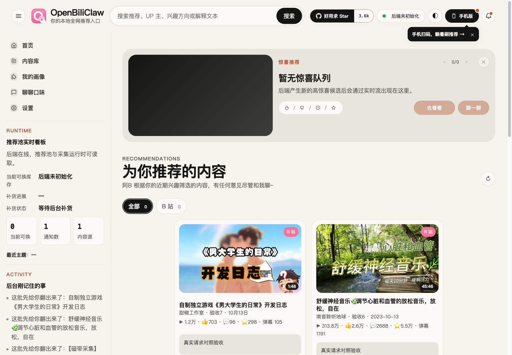

# 封面优化：真实请求交替对照验收（2026-10-23）

## 结论

本机真实 Chromium + FastAPI + 图片服务的交替对照中，前四张推荐封面完成的中位数从 **2.079s 降到 1.664s（约 20%）**，八张完成从 **2.582s 降到 2.259s（约 13%）**。图片请求前排队明显减少。四组对照有三组优化后更快；首组优化后的整页图片完成更慢，完整记录保留，不仅报告最快样本。

## 方法与真实性

- 优化前为 `58d066c6`，端口 18476；优化后为 `78f35cc1`，端口 18477。两个 worktree 均为干净提交。
- 两个实际 API 进程使用独立临时配置和数据库，复制同样的 8 条已有真实内容，固定顺序与推荐文案标记。共用实际图片服务 18478，排除两端服务端缓存冷热不一致。两端模型配置相同且后端正常启动，没有发模型对话请求。
- 用专用 Chromium 1440×1000 访问完整 `/web/` 页面，无请求拦截、无响应替换、无 Chrome API stub。浏览器 HTTP 缓存关闭。等待实际推荐文案与 8 张卡片，排除离线演示数据；每张图片须 complete 且 naturalWidth>0。
- 首先各做一次预热，再按 **A B B A B A A B** 顺序交替测试，A 为旧版，B 为新版。每个正式轮次的 8 张图片均通过真实代理请求且命中相同的服务端缓存。
- 记录导航起点到卡片就绪、前四张图片完成、滚动后八张图片完成的时间；从 Resource Timing 按 DOM 中前四张图片 URL 取排队和请求耗时。八张完成含测试脚本滚动耗时，不等于纯下载时间。
- 每轮等待 16 个收藏／稍后再看状态请求和辅助队列的 QR 信息请求完成。正式 8 轮共 **64 张图片均 HTTP 200、128 个逐卡状态读取完成**，观察到的 API 响应没有 4xx/5xx。预热加正式共 80 张图片请求，全部成功。
- 初次预热的 8 张图片全部 cache miss，从真实 CDN 下载；前四张约 5.99s，八张约 7.06s。第二次预热已命中缓存，因此两次预热不用于速度比较。本次不证明冷 CDN 下载速度变快。
- 未运行后台采集、鱼互动、发评论或私信；未动用户日常浏览器或主配置。数据库没有完整画像与初始化历史，页面因此显示“后端未初始化”，但实际推荐与图片接口使用正常运行时和固定真实内容。这是受控的真实链路验收，不是生产账号的完整初始化或推荐质量验收。

## 汇总（正式轮次）

页面完成时间取四轮中位数；图片排队／请求耗时取各版本 4 轮×前 4 张共 16 个样本中位数。

| 指标 | 优化前 | 优化后 | 变化 |
| --- | ---: | ---: | ---: |
| 卡片 DOM 就绪 | 1.444s | 1.485s | 略慢，波动范围内，不宣称改善 |
| 前四张封面完成 | 2.079s | 1.664s | 约快 20% |
| 八张封面完成（含滚动） | 2.582s | 2.259s | 约快 13% |
| 前四张图片排队 | 436.7ms | 3.5ms | 约减少 99% |
| 前四张图片请求总耗时 | 594.7ms | 236.6ms | 约减少 60% |

## 每轮结果

| 版本／轮次（执行顺序） | 卡片就绪 s | 前四张完成 s | 八张完成 s | 前四张排队中位数 ms |
| --- | ---: | ---: | ---: | ---: |
| A 1 | 1.18 | 1.65 | 2.14 | 356.0 |
| B 1 | 1.57 | 1.81 | 2.65 | 4.0 |
| B 2 | 1.25 | 1.42 | 2.16 | 2.8 |
| A 2 | 1.73 | 2.14 | 2.69 | 393.0 |
| B 3 | 1.50 | 1.68 | 2.20 | 6.1 |
| A 3 | 1.39 | 2.02 | 2.51 | 475.4 |
| A 4 | 1.50 | 2.16 | 2.65 | 500.8 |
| B 4 | 1.47 | 1.65 | 2.32 | 4.6 |

[原始脱敏数值](assets/2026-10-23-cover-live-ab/results.json) 保留预热与全部正式轮次，不包含 URL、Cookie 或模型密钥。样本数小，受本机负载影响；这里的“前四张完成”不是浏览器 LCP，“八张完成”也不代表实时流和所有后台任务终止。不能将这些指标推广为 Windows/Edge 或全部用户的生产 P95。

## 画面与交付

本轮未新增生产代码修改；51 项相关回归在优化提交中已通过，本轮专门补真实请求对照，没有重复运行。完成后停止本轮三个服务与专用浏览器，删除临时配置、内容副本和日志；仅保留脱敏结果与截图。未合入 main 或发布。
