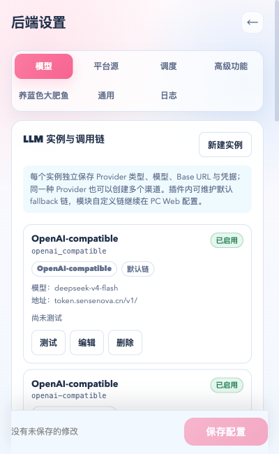
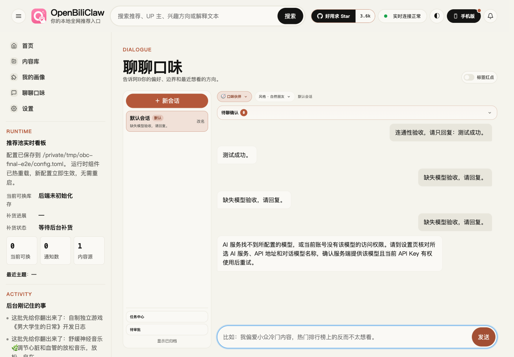
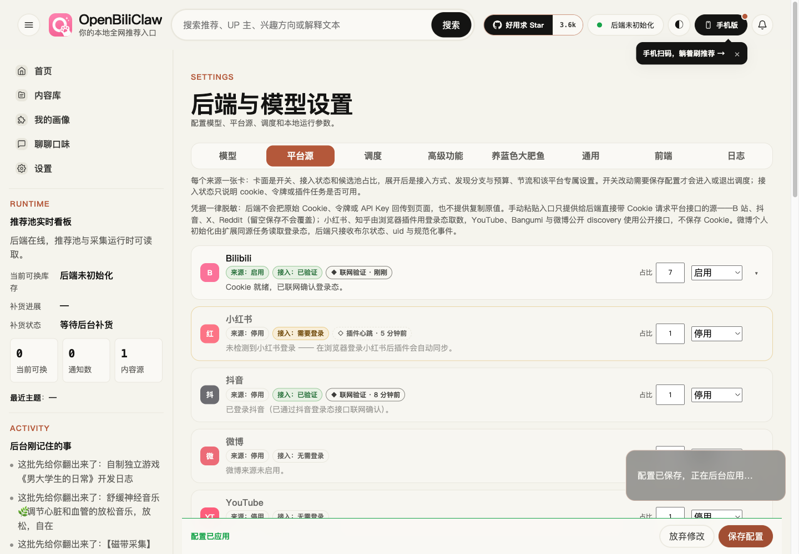
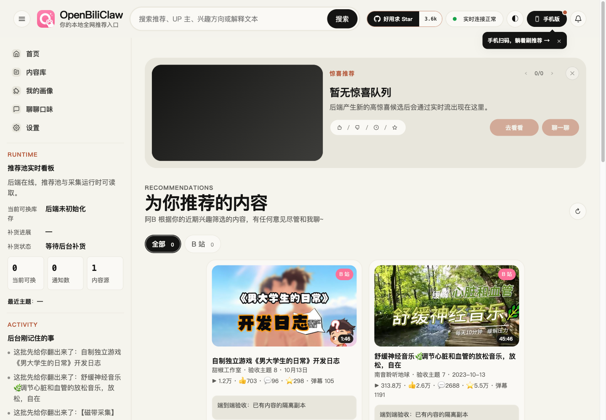

# 近期修复端到端复测（2026-10-23）

## 环境与结论

在 `fix/extension-layout-cover-latency` 独立 worktree，以 `8dad7894` 为本轮起点，运行真实 Chromium、实际加载的 MV3 扩展、真实 FastAPI（8420）和独立图片服务（18475）。远程模型与 B 站图片、二维码接口使用真实 HTTP，没有替换响应。配置、数据库、浏览器 profile 均使用临时目录，模型设置从已有本机配置复制。后台采集和鱼自动互动关闭，没有发布评论或私信。

端到端发现一个之前测试遗漏的插件错误：小鱼面板传入 `/api/fish/*`，公共 `requestJson` 再添加 `/api`，实际请求成为 `/api/api/fish/*` 并返回 404。本轮修正所有面板入口为 `/fish/*`，增加公共 helper 与实际面板事件的组合回归。后端 API、配置字段和模块接线未变。

## 真实操作结果

| 项目 | 观察与结果 |
| --- | --- |
| 插件设置布局 | 实际 MV3 页面在 320、375、400、480、600px 下逐个点击七个分类，均可见且对应面板打开；页面 scrollWidth 等于 clientWidth（280、335、360、440、560px）。 |
| 插件小鱼设置 | 修正后配置/状态请求 200；实际保存人设名称得到 200，刷新后仍为验收名称，自动运行保持关闭。 |
| 插件扫码入口 | 实际二维码生成 200、SVG 显示，发起真实轮询。本轮没有手机确认，最后账号状态 has_cookie=false、authenticated=false；不能宣称本轮重新登录通过。上一轮用户实际扫码登录成功见下方旧报告。 |
| 远程模型 | 正常模型实际回复“测试成功。”；临时切换为不存在模型，上游明确 404 / model is not found，页面提示核对所选服务、API 地址、模型名称及权限，没有 Ollama 文案。之后恢复原模型，配置应用成功。 |
| 配置保存 | 页面修改 Bilibili 候选池占比，真实 PUT 202；等待 WebSocket 连接后注入丢弃完成事件，实际丢掉 1 条 config_reloaded，真实状态查询 1 次，约 1490ms 后显示“配置已应用”。HTTP、重建流程及状态查询均未 mock。 |
| 聊天布局 | 1920、1440、1024、768、375px 下聊天区宽度分别约 1516.81、1049、633、729、336px；文档均无横向溢出，1440px 截图检查通过。 |
| 推荐图片 | 使用已有真实内容的 8 条隔离数据库副本，经实际推荐接口交付；明确等待验收文案，排除离线演示数据。8 张图片全部 HTTP 200 且 naturalWidth>0。此项不验收推荐算法质量或惊喜头图。 |

本轮模型错误探针最初等待页面字面量 `HTTP 404` 超时。检查实际上游日志与页面后确认：页面使用友好提示而不包含原始状态码。报告以真实上游 404 和最终提示作为依据，不把探针断言错误当作产品故障。

## 图片性能：整页与单接口分开记录

测试禁用浏览器 HTTP 缓存，保留服务端缓存。首次清空本次隔离图片缓存并重启本次图片服务，8 张真实 CDN 图片冷加载：图片请求约 1.61–2.72s，前四张完成 3.59s，全八张完成 4.58s。此时并行运行后端 pytest；随后热加载一度出现图片 4.28–4.72s、前四张 6.09s。

pytest 完成后重开专用浏览器，在同一服务上连续复测两轮：

| 轮次 | 前四张完成 | 全八张完成 | 图片请求 | 服务端缓存 |
| --- | --- | --- | --- | --- |
| 1 | 2.60s | 3.08s | 0.71–0.86s | 全部 hit |
| 2 | 2.12s | 2.61s | 0.61–0.81s | 全部 hit |

第二轮浏览器 Resource Timing：图片请求前排队约 0.49–0.76s；请求到首字节约 0.05–0.15s；传输约 0.004–0.042s。缓存后瓶颈已不主要在图片渲染，浏览器排队仍占多数。这是小样本，不是生产 P95，也不能严格分离 pytest 负载与重开浏览器的各自影响；不能将首次热加载异常直接归因于后端产品代码。没有基于该异常再引入未经证实的性能改动。

此前单独接口对照的加速数据保留在 [布局与封面延迟报告](2026-10-23-popup-cover-latency.md)，不能用单接口数据替代本次整页耗时。当前不能保证用户 Windows 网络环境也达到相同速度。

## 回归与范围限制

- `node --test --experimental-strip-types tests/popup-api.test.ts tests/popup-fish-endpoints.test.ts`：58 passed；新增测试修复前可复现重复前缀失败。
- `pytest tests/test_fish_api.py tests/test_bilibili_api.py -q`：79 passed，60 条现有 FastAPI on_event 弃用警告，110.62s。
- `npm run build`：通过，Chrome 资源预检 22 项通过。
- `git diff --check`：通过。本轮新增生产修改仅为插件 JS 请求路径，没有 Python 类型或接口变更。
- 真实 MV3 扩展使用 chrome-extension 页面和实际 service worker；以独立页设置视口验证面板宽度，没有操作浏览器原生工具栏/side panel 容器，不能视作容器本身的完整验收。
- 当前为 macOS Chromium，未验证用户 Windows 安装包、Edge 原生颜色/禁用选项问题，亦未连接用户那台 LM 服务器。远程缺失模型路径已验证不等于该服务器配置正确。
- 本轮 QR 未获手机确认；此前真实扫码、较长对话占用时配置等待的结果见 [上一轮真实服务记录](2026-10-23-user-fixes-live.md)。本轮不冒充新的扫码成功。
- 完成后清除临时鱼账号、关闭本轮服务和浏览器，删除临时密钥配置、数据库、二维码与日志。没有合入 main 或发布。
