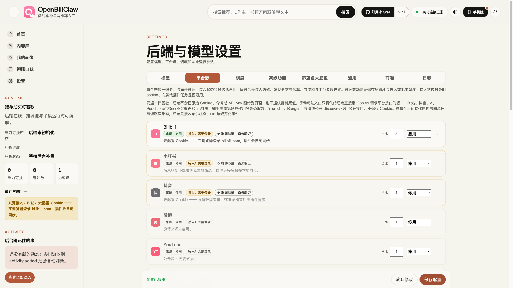
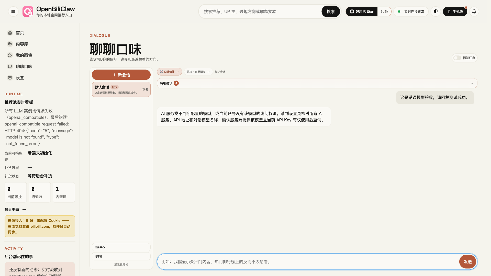
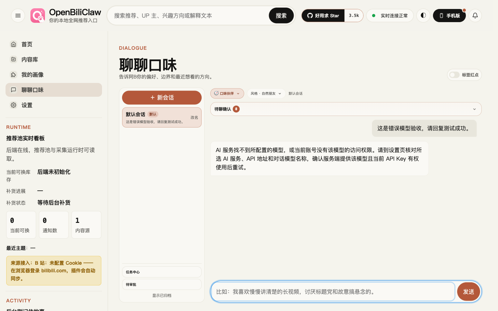

# 用户反馈修复：真实服务验收（2026-10-23）

## 环境与范围

在独立 worktree、分支 `test/user-fixes-live` 集成 `c79ec6af`、`0d06b564`、`bf063b0c`，集成后的提交分别为 `661cc12a`、`d6e695ad`、`163de331`。使用 macOS、实际 Chromium 和本机真实 API 服务（端口 18473），复制现有模型服务配置至临时私有目录，使用全新数据库。没有替换 HTTP 响应或模拟外部模型、B 站接口。

验收未启动后台内容采集与鱼自动互动循环，没有发布评论或私信。主账号未配置，因此不把这次扫码结果视为“真实主账号与小号冲突拒绝”的验收。Windows 打包程序、用户电脑上的部署及 Edge 颜色问题不在本次已验证范围内。

## 结果

| 项目 | 真实执行及观察 | 结果 |
| --- | --- | --- |
| 小号扫码 | 首次二维码超时；重新生成后由用户手机确认，实际轮询经历 pending → scanned → logged_in，认证通过且 Cookie 落盘；配置热重载后再次校验仍有效 | 通过 |
| 保存配置卡住 | 浏览器修改平台占比并保存，真实 HTTP 202 后进入应用流程；并发真实对话占用执行通道时显示等待对话、等待学习任务和重建运行时，最终应用成功 | 通过 |
| 模型错误提示 | 正常模型真实请求返回“测试成功。”（约 2.88 秒）；临时设定不存在模型，实际上游返回 HTTP 404 / model is not found，浏览器及持久化对话均显示核对模型、API 地址与权限，无本地 Ollama 误导；随后恢复模型，另一真实对话返回 795 字符 | 通过 |
| 聊天布局 | 实际页面在五种宽度测量，聊天工作区占满布局可用宽度，文档无横向溢出；检查桌面截图 | 通过 |

### 漏通知故障注入

浏览器初始化脚本仅拦截传给页面监听器的 `config_reloaded` / `config_reload_failed` WebSocket 消息；连接、保存请求、状态查询、运行时重建与模型请求均保持真实。

首次保存漏收 1 条完成事件后，约 2.75 秒由状态查询恢复。进一步在真实对话执行中保存：漏收 1 条完成事件，6 次真实状态查询，约 13.04 秒后页面显示“配置已应用”。观察到的中间提示包括“正在等待当前对话结束，再应用配置”和“正在等待对话学习任务结束并重建运行时配置”。这覆盖了持续等待及漏收完成通知的成功恢复；未在真实服务上强制造成重建失败，失败状态由已有回归测试覆盖。

### 模型提示与布局

本次实际模型为已配置的远程 OpenAI-compatible 服务，不是用户 Windows 上的 LM 服务实例；证明真实远程缺失模型响应的处理路径，不能据此确认用户那台服务器的模型配置正确。

| 视口宽度 | 聊天宽度 | 可用宽度 | 横向溢出 |
| --- | --- | --- | --- |
| 1920 | 1516.81 | 1516.80 | 无 |
| 1440 | 1049 | 1049 | 无 |
| 1024 | 633 | 633 | 无 |
| 768 | 729 | 729 | 无 |
| 375 | 336 | 336 | 无 |

测量差异小于 0.02 像素为布局舍入。窄屏这里只验证几何布局，不代表全部移动端交互验收。

## 自动回归与清理

- `pytest tests/test_llm_service.py tests/test_bilibili_api.py tests/test_fish_api.py -q`：178 passed，60 warnings，102.55 秒；不是全仓测试结果。
- `ruff check src/ tests/`：通过。
- 通过真实 `DELETE /api/fish/account` 清除临时账号，返回 HTTP 200，并确认 Cookie 文件已不存在。
- 临时服务与专用浏览器在验收后关闭，临时模型密钥配置与扫码材料删除。截图不含 Cookie、API Key 或二维码。
- 本次只记录验收结果，没有新增生产代码修改；尚未合入 main 或发布安装包。
